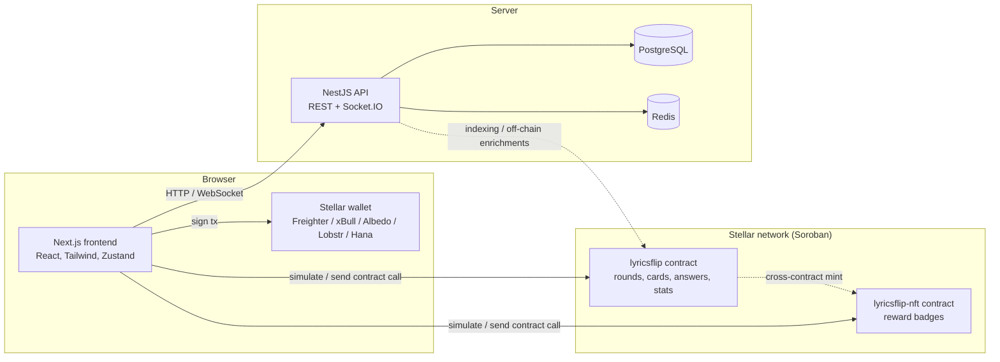
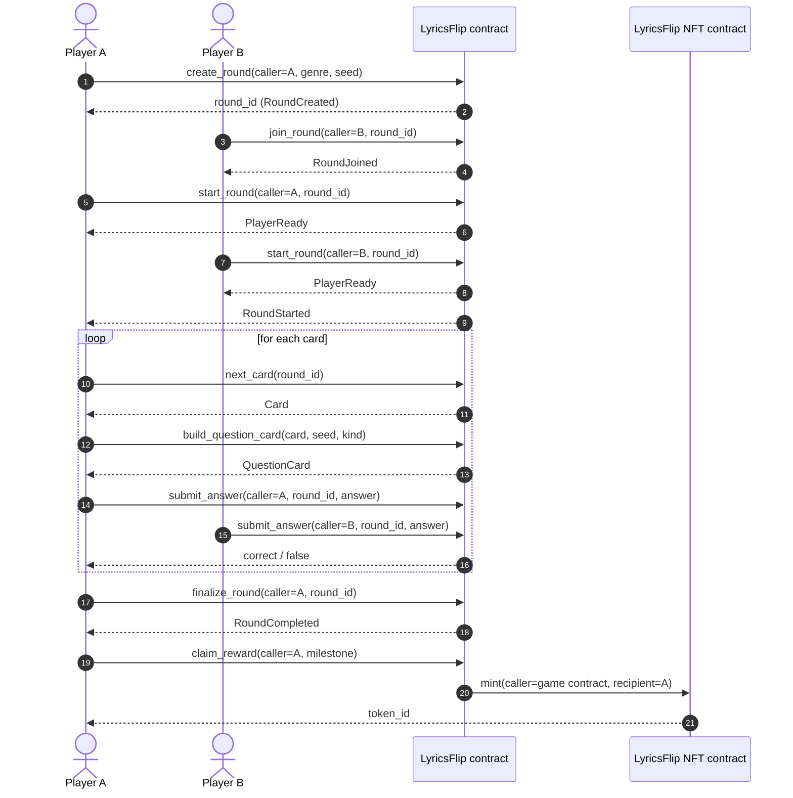

# Architecture

This document stays aligned with the project README, especially the "How the game works" flow and the architecture summary.

## Component overview

## Round lifecycle

## Lifecycle and ownership summary

The game flow matches the README's player-facing flow:

1. Create a round.
2. Invite players and let them join.
3. Everyone marks ready.
4. The round starts on-chain.
5. Each card is drawn and answered.
6. The round is finalized.
7. Milestone claims mint reward NFTs.

## Data ownership: chain vs. database

| Concern | Source of truth | Notes |
|---|---|---|
| Game state and fairness | Stellar chain / Soroban contracts | Round state, card catalogue, answer checks, winner selection, per-player stats, minting flows |
| NFT ownership and rewards | Stellar chain / NFT contract | Token ownership and transfer history are on-chain |
| Wallet signers and session UX | Frontend only | The browser keeps the wallet connection and local UI state; it does not own persisted game truth |
| Profiles, leaderboards, chat, notifications, realtime relay | Backend database | PostgreSQL/Redis store off-chain social data, metadata, and real-time sessions |
| Song metadata and curation | Backend database and API | The chain stores gameplay facts; the backend stores non-critical social or editorial data |
| Contract event indexing | Backend indexer / API | Useful for analytics, feeds, and UI queries beyond raw on-chain reads |

## Ownership model

- The Soroban contracts are the source of truth for all value-bearing and fairness-critical state.
- The frontend is a client that reads chain data and submits signed transactions.
- The backend is an off-chain extension that enriches the game with profiles, social features, and indexable events.
- The contract is not replaced by the database; the database is for user experience and operational data, not game authority.

## Sign-in flow (LF-204)

`/sign-in` is the single entry point for authentication. Routes that need an
account (`/notifications`, `/set-username`) are wrapped in
`components/providers/require-account.tsx`, which sends visitors to
`/sign-in?next=<path>` when a step is missing.

1. **Connect wallet.** `connect()` opens the Stellar Wallets Kit modal.
2. **Sign the challenge (LF-228).** `connect()` then calls
   `POST /api/v1/auth/challenge`, signs the challenge with
   `StellarWalletsKit.signMessage`, and exchanges it at
   `POST /api/v1/auth/verify` for a session. On a page reload the session is
   restored from the refresh cookie instead, so the user doesn't sign again.
3. **Set a username, on first login only.** If the wallet has no username yet,
   `/sign-in` continues to `/set-username?next=<path>`. Returning users skip
   this step and go straight to `next`. Until the backend profile endpoint
   (`PATCH /user/me/profile`) is implemented, the username is remembered in
   this browser (`frontend/src/store/use-profile-store.ts`).

The old `/notifications/notifications` path redirects to `/notifications`.

### Auth tokens (LF-202)

- The **access token** is kept in memory only (`frontend/src/services/api.ts`)
  and sent as a `Bearer` header. On a `401` the client refreshes it once and
  retries the request.
- The **refresh token** is an `HttpOnly; Secure; SameSite=Lax` cookie, scoped to
  `/api/v1/auth`, set by `verify` and rotated by `refresh`. `logout` revokes its
  token family and clears it. No auth token is stored in `localStorage` or
  `sessionStorage`.
- CORS allows credentials only from the configured origins (`CORS_ORIGINS`,
  defaulting to `FRONTEND_URL` or `http://localhost:3000`). A wildcard origin
  can't be used with credentials.
- **CSRF:** the cookie-authenticated routes (`refresh`, `logout`) require the
  `X-Requested-With: XMLHttpRequest` header, which the API client always sends.
  Cross-site forms can't set it, and cross-origin scripts fail the CORS
  preflight.

## Architecture Decision Records

Significant decisions are recorded as ADRs in [`docs/adr/`](./adr/). Each ADR follows the [template](./adr/template.md) (context, decision, consequences, status) and stays *Proposed* until a maintainer accepts it. Every issue that depends on a decision links to its ADR.

| ADR | Decision | Status |
|---|---|---|
| [ADR-0001](./adr/0001-answer-privacy.md) | Answer privacy (LF-142) | Proposed |
| [ADR-0002](./adr/0002-randomness-source.md) | Randomness source (LF-143) | Proposed |
| [ADR-0003](./adr/0003-escrow-design.md) | Escrow design (LF-135) | Proposed |
| [ADR-0004](./adr/0004-nft-transferability.md) | NFT transferability (LF-169) | Proposed |
| [ADR-0005](./adr/0005-backend-scope.md) | Backend scope (LF-226) | Proposed |
| [ADR-0006](./adr/0006-realtime-source-of-truth.md) | Source of truth for real-time state (LF-225) | Proposed |

## Implementation notes

- The frontend reads from the chain and the API; it never becomes the authoritative store for game state.
- The `lyricsflip` contract owns the round logic and answer validation.
- The `lyricsflip-nft` contract owns the reward token lifecycle and ownership semantics.
- The backend can index contract events, but the chain remains the root of trust.
