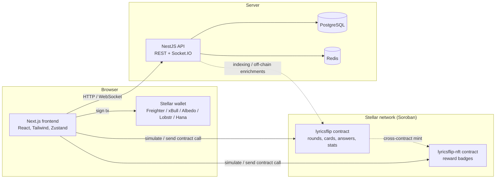
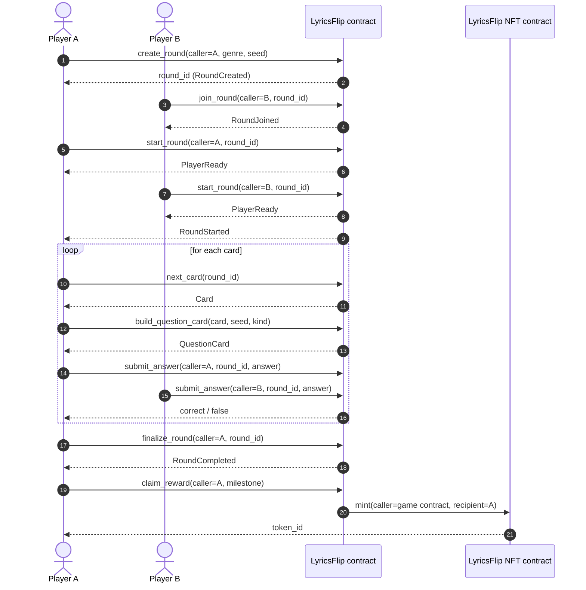

# Architecture

This document stays aligned with the project README, especially the "How the game works" flow and the architecture summary.

## Component overview

## Round lifecycle

## Lifecycle and ownership summary

The game flow matches the README's player-facing flow:

1. Create a round.
2. Invite players and let them join.
3. Everyone marks ready.
4. The round starts on-chain.
5. Each card is drawn and answered.
6. The round is finalized.
7. Milestone claims mint reward NFTs.

## Data ownership: chain vs. database

| Concern | Source of truth | Notes |
|---|---|---|
| Game state and fairness | Stellar chain / Soroban contracts | Round state, card catalogue, answer checks, winner selection, per-player stats, minting flows |
| NFT ownership and rewards | Stellar chain / NFT contract | Token ownership and transfer history are on-chain |
| Wallet signers and session UX | Frontend only | The browser keeps the wallet connection and local UI state; it does not own persisted game truth |
| Profiles, leaderboards, chat, notifications, realtime relay | Backend database | PostgreSQL/Redis store off-chain social data, metadata, and real-time sessions |
| Song metadata and curation | Backend database and API | The chain stores gameplay facts; the backend stores non-critical social or editorial data |
| Contract event indexing | Backend indexer / API | Useful for analytics, feeds, and UI queries beyond raw on-chain reads |

## Ownership model

- The Soroban contracts are the source of truth for all value-bearing and fairness-critical state.
- The frontend is a client that reads chain data and submits signed transactions.
- The backend is an off-chain extension that enriches the game with profiles, social features, and indexable events.
- The contract is not replaced by the database; the database is for user experience and operational data, not game authority.

## Sign-in flow (LF-204)

`/sign-in` is the single entry point for authentication. Routes that need an
account (`/notifications`, `/set-username`) are wrapped in
`components/providers/require-account.tsx`, which sends visitors to
`/sign-in?next=<path>` when a step is missing.

1. **Connect wallet.** `connect()` opens the Stellar Wallets Kit modal.
2. **Sign the challenge (LF-228).** `connect()` then calls
   `POST /api/v1/auth/challenge`, signs the challenge with
   `StellarWalletsKit.signMessage`, and exchanges it at
   `POST /api/v1/auth/verify` for a session. On a page reload the session is
   restored from the refresh cookie instead, so the user doesn't sign again.
3. **Set a username, on first login only.** If the wallet has no username yet,
   `/sign-in` continues to `/set-username?next=<path>`. Returning users skip
   this step and go straight to `next`. Until the backend profile endpoint
   (`PATCH /user/me/profile`) is implemented, the username is remembered in
   this browser (`frontend/src/store/use-profile-store.ts`).

The old `/notifications/notifications` path redirects to `/notifications`.

### Auth tokens (LF-202)

- The **access token** is kept in memory only (`frontend/src/services/api.ts`)
  and sent as a `Bearer` header. On a `401` the client refreshes it once and
  retries the request.
- The **refresh token** is an `HttpOnly; Secure; SameSite=Lax` cookie, scoped to
  `/api/v1/auth`, set by `verify` and rotated by `refresh`. `logout` revokes its
  token family and clears it. No auth token is stored in `localStorage` or
  `sessionStorage`.
- CORS allows credentials only from the configured origins (`CORS_ORIGINS`,
  defaulting to `FRONTEND_URL` or `http://localhost:3000`). A wildcard origin
  can't be used with credentials.
- **CSRF:** the cookie-authenticated routes (`refresh`, `logout`) require the
  `X-Requested-With: XMLHttpRequest` header, which the API client always sends.
  Cross-site forms can't set it, and cross-origin scripts fail the CORS
  preflight.

## Backend module map (LF-348)

`AppModule` imports exactly seven public domain modules. A domain is the sole owner of its tables, HTTP prefixes and WebSocket namespaces; folders inside a domain are implementation details. The machine-readable source of truth is `backend/src/domains/domain-map.ts`, enforced by `backend/src/domains/domain-map.spec.ts` and `backend/src/entity-metadata.spec.ts`.

| Domain | Public module | Internal folders | HTTP prefixes | WebSocket namespaces | Owned tables |
|---|---|---|---|---|---|
| Identity | `IdentityModule` | `auth`, `user`, `player` | `/auth`, `/user` | — | `users`, `players`, `password_reset_tokens`, `user_activity` |
| Catalogue | `CatalogueModule` | `songs`, `questions` | `/songs`, `/questions` | — | `songs`, `tags`, `user_genre_preferences`, `questions` |
| Rounds (chain mirror) | `RoundsModule` | `game`, `game-session`, `game-results`, `quick-game`, `room`, `scoring`, `wager`, `indexer`, `rounds`, `tournament` | `/rounds`, `/game-modes`, `/game-results`, `/wagers`, `/scoring`; legacy `/game-session`, `/quick-game/rounds`, `/rooms` | `/game`, `/rooms`, `/indexer`; `/rounds` relay | `game_sessions`, `rooms`, `player_rooms`, `game_results`, `wagers`, `scoring`, `custom_game_modes`, `tournament`, `indexer_state`, `chain_round`, `chain_round_player`, `chain_answer`, `chain_round_result`, `chain_nft`, `processed_event` |
| Realtime | `RealtimeModule` | `notification`, `realtime` | `/notifications` | `/notifications` | `notifications`, `chat_rooms` |
| Social | `SocialModule` | `social`, `leaderboard`, `referral` | `/players`, `/leaderboard`, `/profile`, `/friends`, `/activity`, `/challenge`, `/referrals` | — | `profile`, `friends`, `activities`, `challenges`, `leaderboards`, `leaderboard_round_results`, `referrals` |
| Rewards | `RewardsModule` | `achievement`, `progression`, `reward`, `rewards` | `/rewards`, `/achievements`, `/progression`; legacy `/reward` | — | `achievement`, `user_achievement`, `player_stats`, `player_level`, `player_skill` |
| Admin | `AdminModule` | `admin`, `analytics`, `player-engagement` | `/analytics`, `/admin/songs` | — | `player_engagement_metrics`, `song_category_metrics`, `token_metrics`, `user_progression_metrics` |

### Legacy route deprecation path

Legacy prefixes remain mounted because existing clients still call them. They are marked `deprecated: true` in Swagger and are owned by the same domain as the canonical route, so there is never a second owner.

| Legacy route or namespace | Canonical owner | Status |
|---|---|---|
| `GET/POST/PATCH/DELETE /api/v1/game-session/*` | `/api/v1/rounds/*` (Rounds) | Deprecated alias |
| `/api/v1/quick-game/rounds/*` | `/api/v1/rounds/*` (Rounds) | Deprecated alias |
| `/api/v1/rooms/*` | `/api/v1/rounds/*` (Rounds) | Deprecated alias; room realtime stays on `/rooms` |
| `/api/v1/reward/*` | `/api/v1/rewards/*` (Rewards) | Deprecated alias |
| `/api/v1/user/players/:address` | `/api/v1/players/:address` (Social) | Deprecated alias |
| Socket.IO `/rounds` | `/game` (Rounds) | Off-chain relay; `/game` follows `docs/realtime-protocol.md` |
| Socket.IO `/notifications` | Realtime | Unchanged |
| Socket.IO `/indexer` | Rounds | Unchanged; single chain-event owner |

`/auth/*`, `/notifications`, `/leaderboard` and `/songs` keep their existing paths; only the duplicated round, reward and profile aliases are deprecated.

### Consolidation inventory

Every pre-consolidation feature folder was assigned an owner or removed. "Infrastructure" folders are cross-cutting and remain outside the domain map.

| Original folder(s) | Entities / tables | Routes / namespaces | Consumers | Final owner |
|---|---|---|---|---|
| `auth/` | `password_reset_tokens` | `/auth` | `UserModule`, `GameModule`, `NotificationModule`, frontend | Identity |
| `user/` | `users`, `user_activity` | `/user`; deprecated `/user/players/:address` | `AuthModule`, frontend | Identity |
| `player/` | `players` | — | scoring, room, social profile | Identity |
| `songs/` | `songs`, `tags`, `user_genre_preferences` | `/songs`, `/admin/songs` | `QuestionsModule`, `AdminModule`, frontend | Catalogue (`/admin/songs` -> Admin) |
| `questions/` | `questions` | `/questions` | `QuickGameModule` | Catalogue |
| `game/` | `custom_game_modes` | `/game-modes`, Socket.IO `/game` (contract protocol) | `AppModule` | Rounds |
| `game-session/` | `game_sessions` | deprecated `/game-session` | `GameModule`, frontend | Rounds (`/rounds`) |
| `game-results/` | `game_results` | `/game-results` | `AppModule` | Rounds |
| `quick-game/` | — | deprecated `/quick-game/rounds` | none | Rounds |
| `room/` | `rooms`, `player_rooms` | deprecated `/rooms`, Socket.IO `/rooms` and `/rounds` | `AppModule`, frontend | Rounds |
| `scoring/` | `scoring` | `/scoring` | `AppModule` | Rounds |
| `wager/` | `wagers` | `/wagers`, deprecated `/rounds` duplicate | `AppModule`, frontend | Rounds |
| `indexer/` | all `chain_*`, `indexer_state`, `processed_event` | Socket.IO `/indexer` | `HealthModule`, `LeaderboardModule`, `AppModule` | Rounds (single chain owner) |
| `tournament/` | `tournament` | — | `game-session.entity.ts` | Rounds (entity moved) |
| `notification/` | `notifications` | `/notifications`, Socket.IO `/notifications` | `SocialModule`, frontend | Realtime |
| `chat-room/` | `chat_rooms` | `/chat-room` (unused) | `Player` relation only | Realtime (entity moved; controller/service removed) |
| `social/` | `profile`, `friends`, `activities`, `challenges` | `/profile`, `/friends`, `/activity`, `/challenge` | `AppModule`, frontend | Social |
| `leaderboard/` | `leaderboards`, `leaderboard_round_results` | `/leaderboard`, `/players` | `UserModule`, `IndexerModule`, frontend | Social |
| `referral/` | `referrals` | `/referrals` | `user.entity.ts` | Social (entity moved) |
| `achievement/` | `achievement`, `user_achievement` | `/achievements` | `AppModule` | Rewards |
| `progression/` | `player_stats`, `player_level`, `player_skill` | `/progression` | none | Rewards |
| `reward/` | — | deprecated `/reward` | frontend | Rewards (`/rewards`) |
| `analytics/` | four `*_metrics` tables | `/analytics` | `AppModule` | Admin |
| `player-engagement/` | metric service only | `/player-engagement` (unused) | `AnalyticsModule` | Admin (service kept, controller/DTO removed) |
| `challenges/` | empty entity stubs | unused stubs | none | removed (knip) |
| `difficulty/` | `difficulties` | — | none | removed (knip) |
| `game-insights/` | DTO/service stubs | `/game-insights` | none | removed (knip) |
| `modules/share/`, `modules/activity/` | `shares`, `share_analytics`, `activity_items` | `/shares` | none | removed (knip) |
| `music-education/` | lesson/quiz/artist tables | `/lessons/*` | none | removed (knip) |
| `power-ups/` | power-up tables | `/power-ups` | none | removed (knip) |
| `practice/` | practice tables | `/practice/*` | none | removed (knip) |
| `state-recovery/` | `game_state`, `state_audit` | duplicate `/state-recovery` registrations | broken `IndexerModule` import | removed (duplicate owner) |
| `common/`, `config/`, `database/`, `exceptions/`, `filters/`, `health/`, `http-yac/`, `interceptors/`, `logger/`, `mail/`, `migrations/`, `redis/`, `utility/` | — | `/health` and cross-cutting hooks | all modules | Infrastructure (unchanged) |
| `_experimental/` | quarantined | quarantined | none | excluded from build and knip |

Knip reported **219 unused files and 24 unresolved imports** before consolidation, and **15 unused files and 0 unresolved imports** after. The remaining 15 are DTOs/interfaces/interceptors inside live modules and are tracked as a follow-up, not dead modules.

## Architecture Decision Records

Significant decisions are recorded as ADRs in [`docs/adr/`](./adr/). Each ADR follows the [template](./adr/template.md) (context, decision, consequences, status) and stays *Proposed* until a maintainer accepts it. Every issue that depends on a decision links to its ADR.

| ADR | Decision | Status |
|---|---|---|
| [ADR-0001](./adr/0001-answer-privacy.md) | Answer privacy (LF-142) | Proposed |
| [ADR-0002](./adr/0002-randomness-source.md) | Randomness source (LF-143) | Proposed |
| [ADR-0003](./adr/0003-escrow-design.md) | Escrow design (LF-135) | Proposed |
| [ADR-0004](./adr/0004-nft-transferability.md) | NFT transferability (LF-169) | Proposed |
| [ADR-0005](./adr/0005-backend-scope.md) | Backend scope (LF-226) | Proposed |
| [ADR-0006](./adr/0006-realtime-source-of-truth.md) | Source of truth for real-time state (LF-225) | Proposed |

## Implementation notes

- The frontend reads from the chain and the API; it never becomes the authoritative store for game state.
- The `lyricsflip` contract owns the round logic and answer validation.
- The `lyricsflip-nft` contract owns the reward token lifecycle and ownership semantics.
- The backend can index contract events, but the chain remains the root of trust.
